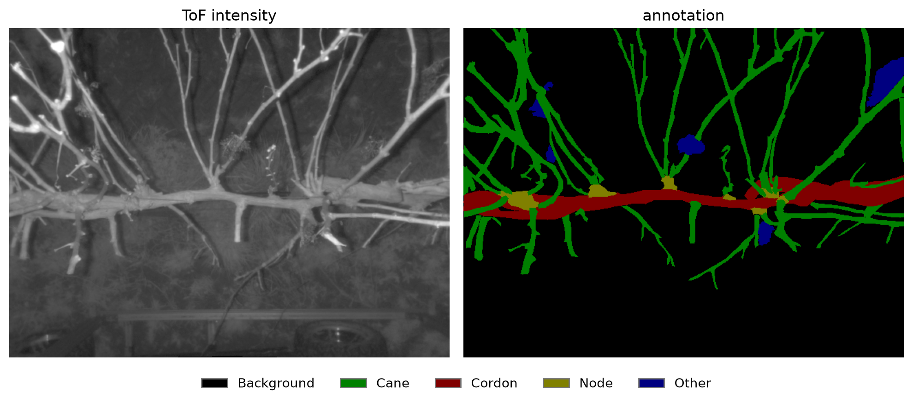
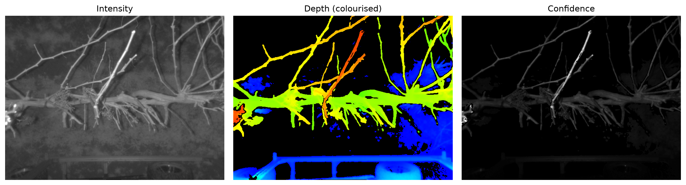
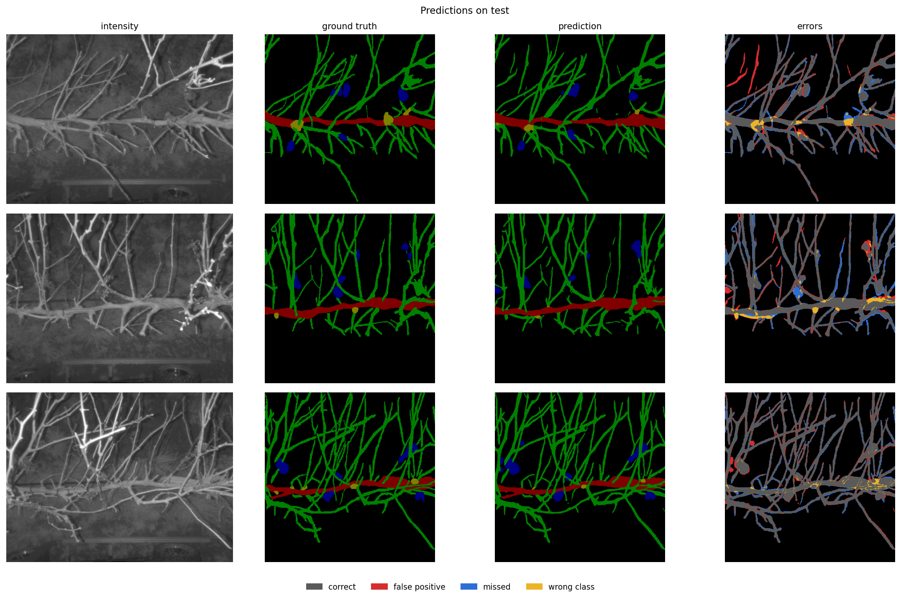

# Semantic Segmentation of Vineyard Components from Time-of-Flight Images

Master's thesis in Data Science, University of Padova (A.Y. 2025/26), developed during an internship at M31.

Winter pruning of grapevines is labour-intensive, and a robotic pruner depends first of all on perceiving the structure of the plant. This project addresses that perception step: the **semantic segmentation of dormant vines** into their functional parts (canes, cordon, the nodes from which the canes emerge, and other elements such as last season's dried bunches) in images from a **Time-of-Flight (ToF) camera**.



## Highlights

- **Dataset built from scratch**: 100 frames acquired in a vineyard near Padua with a ToF camera mounted on an over-the-row gantry, annotated by hand in LabelMe.
- **Multimodal input**: intensity, colorised depth and confidence stacked into a 5-channel tensor.
- **Three encoder-decoder architectures implemented from scratch** at matched capacity: U-Net, SegNet and PSPNet.
- **Topology-aware evaluation and training**: clDice to measure the connectivity of thin structures, and the Skeleton Recall Loss as an auxiliary objective.
- **Measured noise floor**: before any comparison, three runs differing only in the random seed showed that two single runs can differ by about 0.02 of mean IoU by chance alone. Every result is read against that threshold, with statistical tests on the differences.
- **Modular, reproducible pipeline**: logic in Python modules, thin notebooks, a single configuration file, and runs fingerprinted with the source code that produced them.



## Results

Architecture comparison on the test split: mean ± standard deviation over three seeds, plain cross-entropy, same training budget.

| Metric | U-Net | SegNet | PSPNet |
|---|---|---|---|
| Mean IoU (foreground classes) | 0.667 ± 0.008 | 0.682 ± 0.002 | 0.634 ± 0.008 |
| Mean clDice | 0.909 ± 0.006 | 0.908 ± 0.002 | 0.866 ± 0.006 |
| IoU Cane | 0.748 ± 0.007 | 0.750 ± 0.003 | 0.663 ± 0.011 |
| IoU Cordon | 0.801 ± 0.007 | 0.804 ± 0.003 | 0.786 ± 0.004 |
| IoU Node | 0.436 ± 0.015 | 0.483 ± 0.003 | 0.421 ± 0.006 |
| IoU Other | 0.685 ± 0.007 | 0.692 ± 0.002 | 0.668 ± 0.013 |
| Seconds per epoch | 32.7 | 52.7 | 29.4 |

Main findings:

- **The simplest configuration wins.** U-Net with plain cross-entropy reaches a mean IoU of 0.67 and a clDice of 0.91, and none of the additions tested improves on it.
- **Class weighting hurts.** The standard remedy for class imbalance costs 0.023 of mean IoU: the weights trade precision for recall, and IoU penalises both errors.
- **PSPNet loses the thin structures.** It gives up 0.085 of IoU on the canes, the thinnest class. SegNet's small lead over U-Net does not clear the noise floor and costs 61% more time per epoch.
- **The Skeleton Recall Loss does what it claims, at a price.** Topological recall rises by 0.026, but the area metrics lose 0.043 of mean IoU. The loss pays off only where the centrelines are broken.
- **The confidence channel is redundant.** It carries no information beyond intensity and depth, and dropping it saves 8–12% of the training time at no measurable cost.



## Repository structure

```
├── src/
│   ├── config.py            paths, hyperparameters, class definitions, run ids
│   ├── data_preparation.py  label maps, skeletons, split, offline augmentation
│   ├── exploration.py       inventory, class distribution, dataset statistics
│   ├── dataset.py           normalisation, online augmentation, dataloaders
│   ├── models.py            U-Net, SegNet, PSPNet, all from scratch
│   ├── losses.py            Dice, combined, focal, skeleton recall
│   ├── metrics.py           confusion matrix, clDice, history tracker
│   ├── training.py          epoch loop, checkpoints, experiment log
│   └── evaluation.py        predictions, error maps, cross-run comparison
├── notebooks/
│   ├── 00_Colab_Smoke_Test.ipynb
│   ├── 01_Data_Preparation.ipynb
│   ├── 02_EDA.ipynb
│   ├── 03_Training.ipynb
│   └── 04_Evaluation.ipynb
├── tools/
│   └── check_config_defaults.py   guard: no default argument may read the config
├── docs/
│   └── pipeline_notes.md    design decisions and their rationale (in Italian)
├── sample_data/             five raw frames from the test split
└── requirements.txt
```

The notebooks stay thin: they import from `src/` and call its functions, so the logic is written once and reused.

## Getting started

```bash
conda create -n vine python=3.11 -y
conda activate vine
pip install torch --index-url https://download.pytorch.org/whl/cpu
pip install -r requirements.txt
```

The code expects the dataset in `data/raw/`, with one folder per modality (`intensity/`, `depth/`, `confidence/`) and the LabelMe annotations in `annotations/`. Set the `VINE_PROJECT_ROOT` environment variable to run from a different location, for example on Colab or Kaggle.

Data preparation runs locally in about 20 seconds. Training was run on Google Colab for GPU memory; `00_Colab_Smoke_Test.ipynb` checks the environment before a session.

## Data availability

The dataset was acquired during the internship and is not publicly released. Five raw frames from the test split, without annotations, are available in [`sample_data/`](sample_data/) to show what the model receives as input.

## Thesis

*Deep Learning-Based Semantic Segmentation of Vineyard Components Using Time-of-Flight Imaging*
Tomas Guarini, supervisor Prof. Tomaso Erseghe, University of Padova, 2026.
